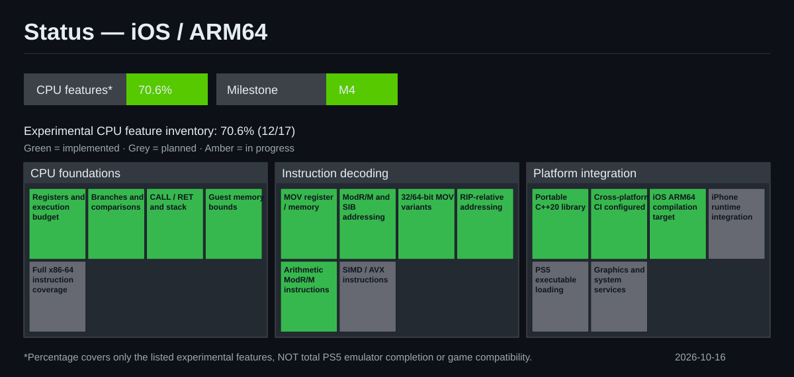

# AnyPS5 experimental iOS / ARM64 CPU progress



The graphic tracks a **feature inventory**, not emulator completion or PS5 game compatibility. A green square means a minimal implementation exists, not that the complete x86-64 semantics have been validated.

## Updating the dashboard

After a major milestone, edit `progress.json` to reflect only features actually implemented, set the milestone and update date, then run:

```sh
python3 experimental/arm64-cpu/render_progress.py
python3 experimental/arm64-cpu/render_progress.py --check
```

Commit `progress.json` and `progress.svg` together. GitHub Actions checks that the SVG is synchronized with its data, in addition to compiling and testing the guest CPU. The dashboard is maintained on the experimental branch; it does not alter the upstream project's completion statistics.

**Status definitions:** implemented = code exists; in_progress = partial implementation; planned = not implemented. See [GitHub Actions](../../.github/workflows/experimental-guest-cpu.yml) for actual CI validation.
